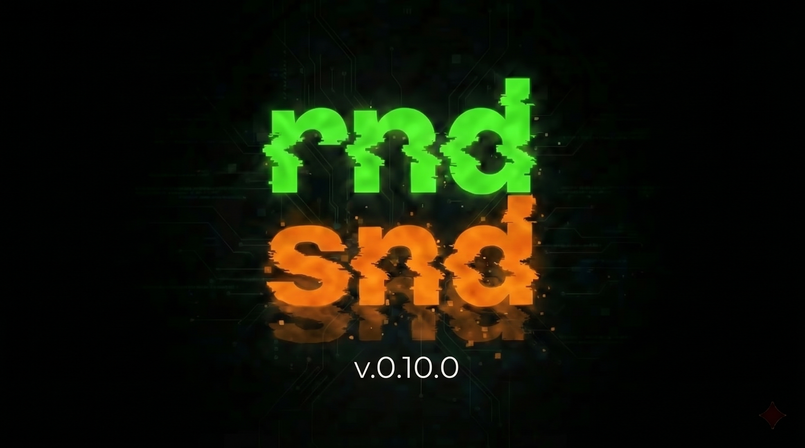
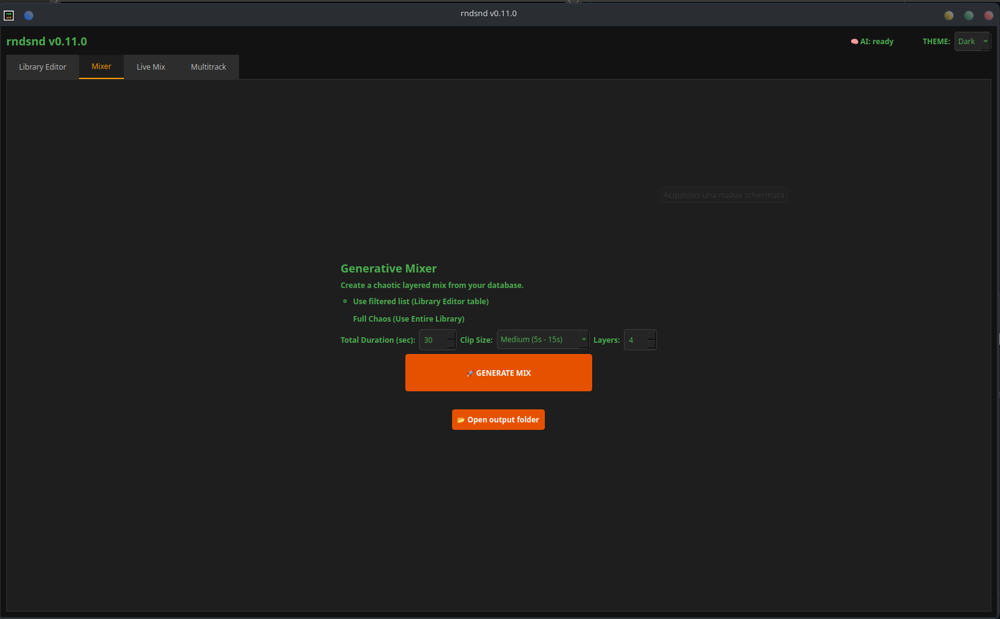
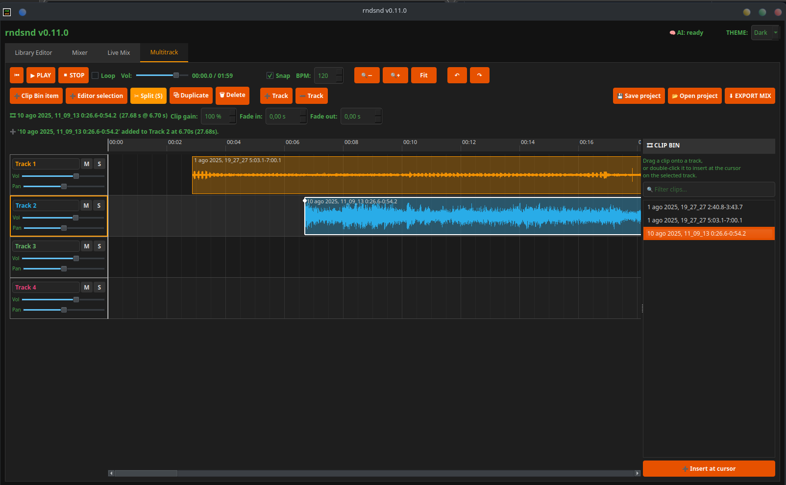
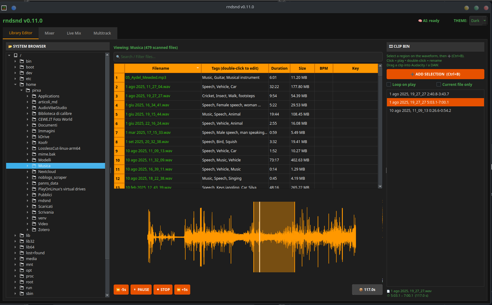
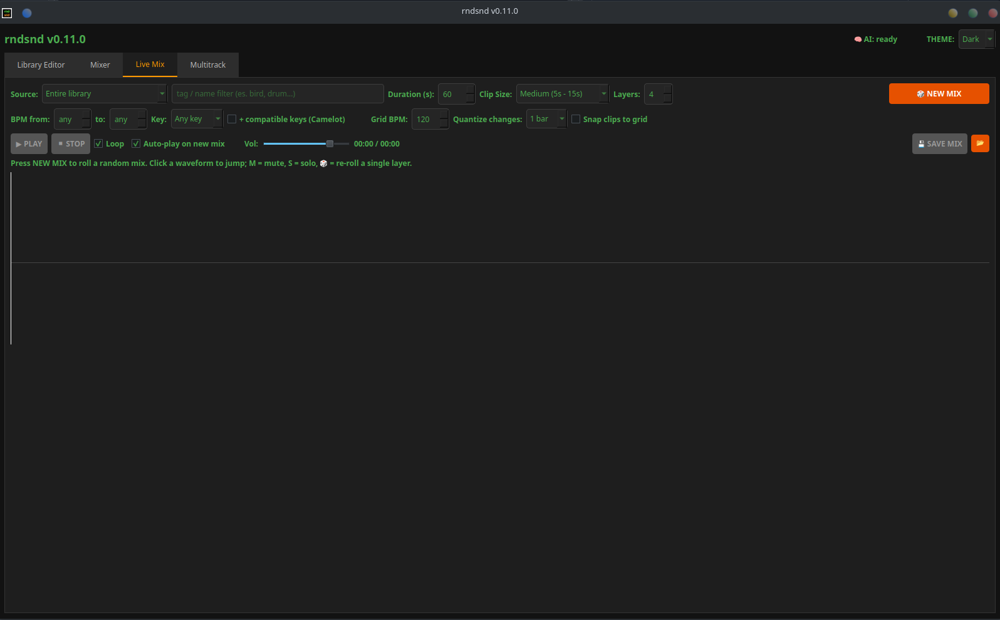

# rndsnd
**Audio Chaos Explorer & Generative Multitrack Studio**

A powerful software to explore, manage, and remix your audio library in new and generative ways. Data, temporary files, and exported mixes are conveniently saved in your local `~/rndsnd` folder.

## What it can do

* **Library Editor & AI Scanner:** Point the app to your audio folders. It will scan them to extract duration and size, using a built-in Artificial Intelligence model (PyTorch / PANNs) to automatically tag your sounds and analyze BPM and musical key.
* **Clip Bin & DAW Integration:** Isolate only the parts you care about! You can select specific portions of an audio waveform and save them as clips in the "Clip Bin". From there, **you can drag and drop these clips directly onto a track in Audacity** (or other DAWs like Ableton and Reaper) to drastically speed up your workflow and beat-making process.
* **Generative Mixer:** Create chaotic, layered mixes offline. Set the duration, the number of overlapping tracks, the clip "grain" size (from micro to extra-long), and let the engine build a random soundscape from your filtered library.
* **Live Mix:** A real-time generative playback engine. It randomly pulls clips from your library based on your filters (including compatible BPM and Camelot keys), applies random panning/volume, and plays them live. You can mute or solo layers, reroll individual layers, and quantize changes to a rhythmic grid (by beat or bar) for perfect transitions.
* **Multitrack Editor:** A non-destructive timeline where you can position your clips, trim them, add fade-ins and fade-outs, adjust pan and volume for each track, and export the final mix.

## Installation

The program is designed to be lightweight and "Plug & Play". To keep the initial download size as small as possible, the heavy Artificial Intelligence engine (PyTorch) and the required AI models (~330 MB) are **not** included in the base download. 
Instead, if you want to use the smart AI Scanner, you can conveniently download and install them directly from within the app by clicking the dedicated "Download AI model" button.

### Windows
1. Go to the **Releases** tab on the right side of the GitHub page.
2. Download the `.zip` package for Windows and extract it into a folder.
3. Double-click the executable file `rndsnd.exe` to launch the program. No installation is required!

**Note for compressed files support (m4a, aac, wma):**
The program natively reads WAV, FLAC, and OGG files. For the Artificial Intelligence to decode and analyze proprietary compressed formats, your system must have `FFmpeg` installed. 
If you don't have it, you can install it in two minutes:
1. Open **Windows PowerShell** as Administrator.
2. Type the command `winget install ffmpeg` and press Enter (accept the terms if prompted).
3. Restart your computer to apply the changes. The next time you launch rndsnd, scanning these formats will work correctly.

### macOS
1. Go to the **Releases** tab on GitHub.
2. Download the macOS package and extract it.
3. Double-click the application. *(Note: on the first launch, you may need to right-click the app, select "Open", and authorize it from the Mac security settings).*

### Linux
1. Go to the **Releases** tab and download the compiled executable for Linux.
2. Make the file executable. From the terminal, type: `chmod +x rndsnd_linux` (or the exact file name).
3. Run it with `./rndsnd_linux` or by double-clicking it.

---

*Alternatively (for Developers):* You can run the app directly from the Python source code. Simply install the basic dependencies (PySide6, librosa, soundfile, matplotlib) and run `python app_desktop.py`. To unlock the intelligent scanner, make sure to also install `torch` and `panns-inference` via pip.

## Screenshots

